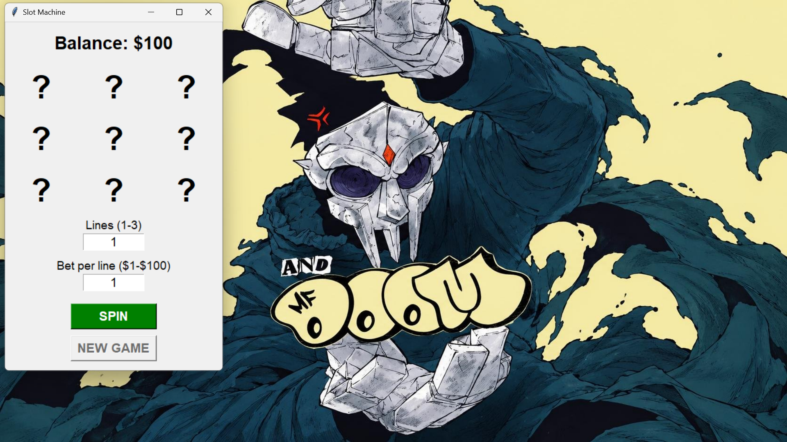

# Slot Machine GUI


A small slot machine game for the desktop, built with Python and Tkinter. Choose how many lines to play and how much to bet per line, then spin the reels.



> **Play money only.** This is a learning project. No real money is involved, and the odds are heavily in the house's favour, so expect your balance to drain.

## Features

- 3x3 reels with four symbols: A, B, C and D
- Play 1 to 3 lines with a bet of $1 to $100 per line
- Start with $100; a game over popup and a NEW GAME button when you run out
- Clear error messages for invalid input
- Game logic covered by pytest tests, run on every pull request with GitHub Actions

## How to play

1. Choose how many lines to play. Lines count from the top: 1 plays the top row, 2 the top two rows, 3 all three rows.
2. Choose your bet per line. Your total bet is lines x bet.
3. Click **SPIN**. A line wins when all three symbols in that row match.

## Payouts

Each column is drawn from a pool of 20 symbols. Rarer symbols pay more.

| Symbol | In each pool of 20 | Pays per winning line |
|--------|--------------------|-----------------------|
| A      | 2                  | 5 x bet               |
| B      | 4                  | 4 x bet               |
| C      | 6                  | 3 x bet               |
| D      | 8                  | 2 x bet               |

## Run it

Requires Python 3 with Tkinter, which is included with the standard Python installers for Windows and macOS. On some Linux systems you may need to install the `python3-tk` package. There are no other dependencies.

```
git clone https://github.com/Nathani21/slot-machine-gui.git
cd slot-machine-gui
python slot_machine.py
```

## Tests

```
pip install pytest
python -m pytest
```

## License

MIT, see [LICENSE](LICENSE).